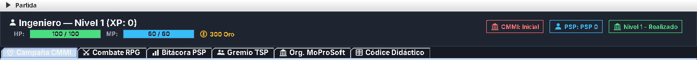
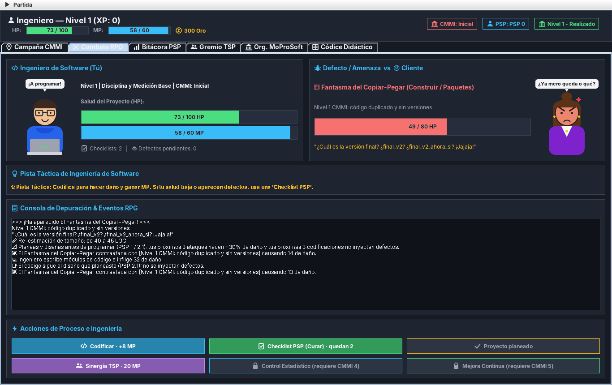
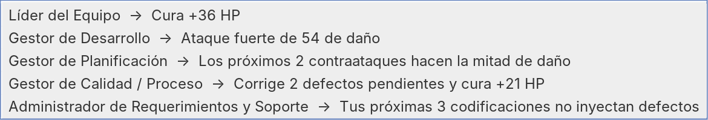
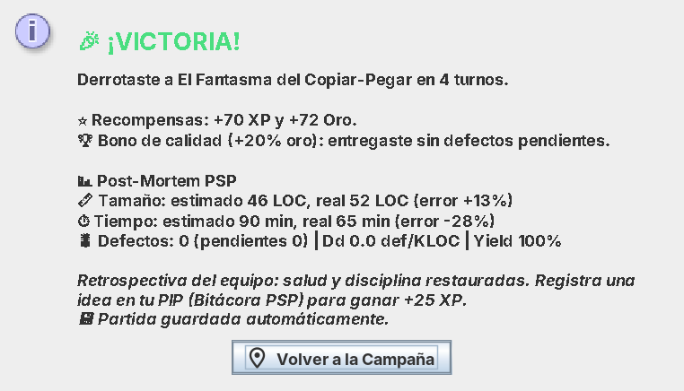
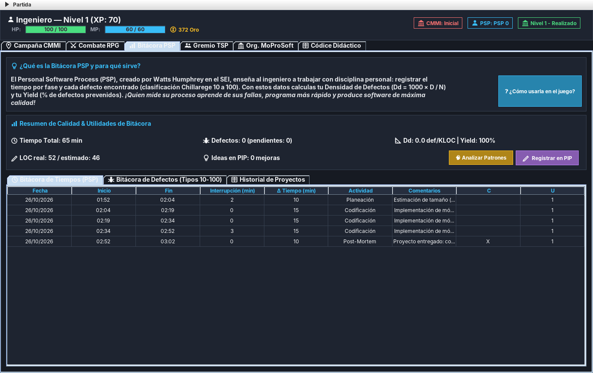
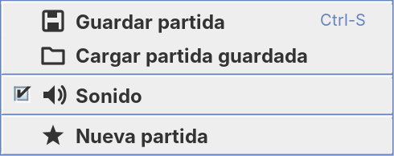

# 📘 Manual de usuario: Software Maturity RPG

Eres un **ingeniero de software**. Cada misión es un proyecto para un cliente y los enemigos son **defectos** (bugs). Gana proyectos, sube de nivel y lleva a tu empresa del caos (CMMI 1) a la excelencia (CMMI 5).

---

## 1. Abrir el juego

Necesitas **Java 17 o más nuevo**.

- **Windows:** doble clic en `SoftwareMaturityRPG.jar` (o en `build_and_run.bat` si tienes el código).
- **Linux:** en una terminal escribe `java -jar SoftwareMaturityRPG.jar`.

La primera vez el juego te pide tu nombre y el de tu empresa. Si ya tienes una partida guardada, te ofrece continuarla.

---

## 2. La pantalla principal

Arriba siempre ves:

| Dato | Qué significa |
|---|---|
| **HP** (verde) | La salud de tu proyecto. Si llega a 0, pierdes la misión. |
| **MP** (azul) | Tu *disciplina*. Se gasta en acciones especiales y se gana al codificar. |
| **Oro** | Tu dinero, para comprar y mejorar. Es la única moneda del juego. |
| **CMMI / PSP / Nivel** | Tu nivel de madurez: el de tu empresa, el tuyo como ingeniero y el de tu organización. |

Debajo están las **6 pestañas**:

| Pestaña | Para qué sirve |
|---|---|
| 🗺️ **Campaña CMMI** | Elegir misión y comprar checklists. **Empiezas aquí.** |
| ⚔️ **Combate RPG** | Pelear contra el defecto. |
| 📊 **Bitácora PSP** | Ver tus tiempos, defectos y resultados (tus métricas). |
| 👥 **Gremio TSP** | Entrenar a tu equipo. |
| 🇲🇽 **Org. MoProSoft** | Mejorar tu empresa. |
| 📖 **Códice Didáctico** | Estudiar la teoría, con tarjetas y un quiz. |

---

## 3. Tu primera misión, paso a paso

### Paso 1: Elige la misión

En **Campaña CMMI**, busca la misión marcada como **⭐ SIGUIENTE MISIÓN** y presiona:

Las misiones se desbloquean en orden. Son 10 en total: dos por cada nivel CMMI.

### Paso 2: Pelea

El juego te lleva a la pestaña **Combate RPG**:

- **Izquierda:** tú, con tu salud (HP), tu disciplina (MP), tus checklists y tus **defectos pendientes**.
- **Derecha:** el defecto que debes vencer y el cliente enojado.
- **Pista táctica:** un consejo para esta misión. ¡Léelo!
- **Consola:** lo que pasa en cada turno.
- **Abajo:** tus acciones. Cada vez que usas una, el enemigo responde con un ataque.

### Paso 3: Usa las acciones

Una buena receta: **Planear → Codificar → Equipo → Checklist cuando haga falta**.

**Qué hace:** tus próximos 3 ataques hacen **+30% de daño** y tus próximas 3 codificaciones no meten defectos. Solo se usa **una vez por misión**.  
**Cuándo:** en tu **primer turno**.

**Qué hace:** daña al defecto y te da **+8 MP**. A veces mete un defecto.  
**Cuándo:** es tu ataque básico; úsalo para juntar MP.

**Qué hace:** pide ayuda a alguien de tu equipo (abre un menú, ver abajo).  
**Cuándo:** cuando tengas 20 MP o más.

**Qué hace:** te **cura** y **corrige hasta 3 defectos** pendientes. Cada una que usas en la misma misión cura menos.  
**Cuándo:** si tu salud baja o tienes 2 o más defectos pendientes.

**Qué hace:** ataque fuerte; entre menos defectos pendientes tengas, más daño hace.  
**Cuándo:** se desbloquea en **CMMI 4**. ¡Los jefes de ese nivel lo necesitan!

**Qué hace:** +50 HP y te sigue curando 3 turnos más.  
**Cuándo:** se desbloquea en **CMMI 5**.

Si un botón está **gris**, no lo puedes usar todavía: te falta MP, te faltan checklists o es de un nivel CMMI más alto. Así se ve uno bloqueado:

> ⚠️ **Ojo con los defectos.** Cada defecto pendiente hace que el cliente te pegue **más fuerte**. Corrígelos con la Checklist o con el Gestor de Calidad.

#### El menú de Sinergia TSP

Al presionar **Sinergia TSP** eliges a quién pedirle ayuda:

| Rol | Úsalo para… |
|---|---|
| **Líder del Equipo** | Curarte. |
| **Gestor de Desarrollo** | Hacer mucho daño. |
| **Gestor de Planificación** | Que los siguientes 2 golpes del enemigo hagan la mitad de daño. |
| **Gestor de Calidad** | Corregir defectos y curarte un poco. |
| **Administrador de Requerimientos** | Que tus próximas 3 codificaciones no metan defectos. |

### Paso 4: El resultado

Al terminar aparece un letrero de **¡VICTORIA!** o **¡PERDISTE!** con tu resumen del proyecto (*post-mortem*):

- Si ganas, recibes **XP** y **oro**. Si entregaste **sin defectos pendientes**, te llevas **+20% de oro**.
- Si pierdes, presiona **🔁 Reintentar**.
- Al terminar, tu salud y tu MP se recuperan solos.

Vencer al **jefe** de cada nivel (la segunda misión del nivel) **sube tu empresa de nivel CMMI** y desbloquea acciones nuevas.

---

## 4. Entre misiones: gasta tu oro

El oro es escaso. Estas son las 3 formas de invertirlo:

**En Campaña CMMI.** Compra una checklist (máximo 5 en tu inventario).

**En Gremio TSP.** Entrena a un miembro del equipo: su ayuda en combate se vuelve **10% más fuerte**.

**En Org. MoProSoft.** Mejora una parte de tu empresa (máximo nivel 3 en cada una).

En **Org. MoProSoft** hay 3 mejoras:

- **DIR (Alta Dirección):** ganas más oro por proyecto.
- **GER (Gerencia):** recibes menos daño.
- **OPE (Operación):** haces más daño y metes menos defectos.

Cada mejora sube el **nivel de capacidad** de tu empresa, de 1 (Realizado) a 5 (Optimizado).

---

## 5. ¿Te falta oro? Caza rápida

En **Campaña CMMI**, este botón te pone a pelear contra un bug pequeño para ganar un poco de XP y oro. **Cada caza paga la mitad que la anterior**: el botón te muestra el porcentaje. Vuelve al 100% cuando subes de nivel CMMI.

---

## 6. Bitácora PSP: tus métricas

Aquí se registra todo automáticamente:

- **Bitácora de Tiempos:** cuánto tardaste en cada actividad (planear, codificar, revisar…).
- **Bitácora de Defectos:** cada bug, con su tipo (10 al 100) y si ya se corrigió.
- **Historial de Proyectos:** el resumen de cada misión. Ahí puedes comparar si mejoras.

Lo más importante del resumen:

- **Dd (densidad de defectos):** defectos por cada mil líneas de código. **Entre más bajo, mejor.**
- **Yield:** el % de defectos que corregiste antes de entregar. **El ideal es 100%.**
- **LOC real / estimado:** qué tanto le atinaste al tamaño del proyecto.

Te dice qué tipo de defecto se repite más en el proyecto actual.

Anota una idea para mejorar (tu *Plan de Mejora Personal*). La primera idea después de cada proyecto te da **+25 XP**.

---

## 7. Códice Didáctico: estudia y gana

- **Biblioteca Teórica:** explicación de CMMI, MoProSoft, PSP y TSP.
- **Flashcards:** lee la pregunta, presiona **🔄 Voltear Tarjeta** y luego **✅ ¡Entendido!**
- **Quiz RPG:** responde preguntas de opción múltiple.

Cada tarjeta y cada pregunta te dan XP y oro **solo la primera vez**.

---

## 8. Guardar y cargar

El juego **se guarda solo** al terminar cada combate. También puedes usar el menú **Partida** (arriba a la izquierda):

- **Guardar partida** (Ctrl+S)
- **Cargar partida guardada**
- **Sonido:** activar o desactivar los efectos.
- **Nueva partida:** empezar de cero.

---

## 9. Consejos rápidos

1. **Planea en tu primer turno.** Es la acción que más rinde.
2. **Codifica para juntar MP** y gástalo en tu equipo.
3. **No dejes acumular defectos:** cada uno hace que el cliente pegue más fuerte.
4. **Invierte tu oro** entre misiones: entrena al equipo y mejora tu empresa.
5. **Usa las acciones nuevas** que desbloqueas en CMMI 4 y 5: los jefes de esos niveles las necesitan.
6. **Lee la pista táctica** de cada misión.

## 10. Problemas comunes

| Problema | Solución |
|---|---|
| El juego no abre o sale *"HeadlessException"* (Linux) | Instala Java completo: `sudo dnf install java-21-openjdk` (Fedora) o `sudo apt install openjdk-21-jre` (Ubuntu). |
| Aparece *"UnsupportedClassVersionError"* | Tu Java es muy viejo. Instala Java 17 o más nuevo. |
| Un botón está gris | Te falta MP, te faltan checklists o es de un nivel CMMI más alto. |
| Pierdo muchas veces la misma misión | Compra checklists, entrena a tu equipo y mejora tu empresa antes de reintentar. |
